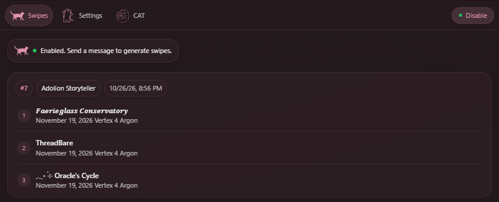
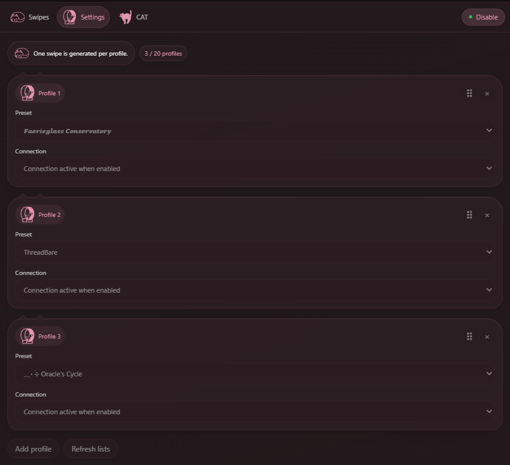
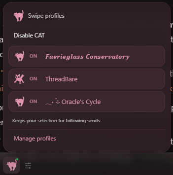

# Concurrent Alternate Trajectories

Otherwise known as CAT, this extension lets you generate several swipes at once, using a seperate preset/model for each swipe. Swipes render their regexes based on the preset that generated it, allowing you to mix and match presets without breaking other messages. Responses stream into each swipe, and they are all navigatable during streaming.

I made this for 3 reasons:

- To help compare presets/variants and see which one works better.
- To generate a fk ton of trajectories and pick the one I like more 💵.
- To help compare models.

Currently, this requires you to be on the Lumiverse Staging branch. You can switch branches in the settings > operator tab, or ask the Discord if you are still confused.

## Nice Things and How To

There is a CAT menu in the Lumiverse sidebar that lets you set up everything. After you set up your preset profiles, additionally:

In this menu, if you want to generate only a subset of your setup preset profiles for your next messages, you can do that via the cat icon in the chat textbar. Here, you can select certain presets you want to use to generate the next message with.

A bonus tip is that this will let you readily switch presets without breaking preset regex for your chat history.

## Be Aware

Having x swipes means x seperate requests, which means 2 swipes will DOUBLE your usage, 3 swipes will TRIPPLE, etc. If you have a cache based setup, ensure you use a seperate connection per swipe profile to maintain caches.

When a chat uses more than one preset through CAT, requests get this instruction injected at the end:

> Note: Your instructions have changed, ensure you only generate prose-adjacent items that are **currently** specified. Do not generate structures based on past messages.

This is to prevent a preset's templates from confusing the AI and bleeding into another preset.

LumiRealm presets are not yet supported.

## TODO

Not much tbh. This is supposed to be small and sweet. Feel free to suggest features though. Reach me at `amousepad` on Discord.

LumiRealm presets will be a god forsaken nightmare to support so no promises there.

## License

AGPL-3.0-only. See [LICENSE](LICENSE).

Cat icons are from Noun Project (CC BY 3.0); see [the icon credits](CREDITS.md) for each creator and source.
